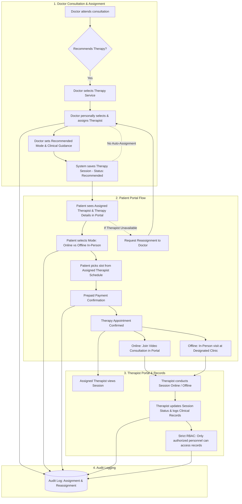

# Therapy Assignment and Patient Portal Implementation Plan

**Project:** Kelkar Manas Health Care (Intima Health Platform)  
**Document:** Therapist Role & Portal Integration Specification  
**Status:** Approved for Implementation (Ready to Execute)

---

## 1. System Overview & Objectives

Kelkar Manas Health Care offers structured mental health and sexual wellness care with both **Online Therapy** (via video consultation) and **Offline (In-Person) Therapy** (at designated clinic locations).

### Core Clinical & Business Rules
1. **Doctor-Recommended Personally Assigned Therapist:**
   - A therapist is **never automatically assigned** by the system.
   - Following a consultation, the doctor personally selects and assigns an appropriate licensed therapist based on diagnosis, clinical suitability, and therapy requirements.
2. **Patient Mode Preference:**
   - Patients can choose between **Online Therapy** (integrated video room) or **Offline (In-Person) Therapy** (clinic visit) according to their preference, clinical suitability, and availability.
3. **Prepaid Scheduling:**
   - Patients select a slot from the **assigned therapist's actual availability schedule** and complete prepaid payment before session confirmation.
4. **Therapist Portal & Clinical Notes:**
   - The assigned therapist conducts the session and updates the therapy session status and clinical records.
5. **Strict RBAC & Privacy:**
   - Clinical records are strictly restricted: therapists only access records of their assigned patients.
6. **Unavailability & Doctor Reassignment:**
   - If the assigned therapist is unavailable, the system notifies the patient and immediately refers the case back to the doctor for reassignment.
7. **Audit Logging:**
   - All therapist assignments, reassignments, mode selections, bookings, payments, and record access are recorded in an audit trail.

---

## 2. End-to-End Workflow Architecture



---

## 3. Data Models & Schema Specifications

### 3.1. Auth & User Schema Updates
- **File:** `src/modules/auth/schema.ts` & `src/modules/auth/types.ts`
- Add `"THERAPIST"` to the `role` enum in `IUser`:
  ```ts
  role: "SUPER_ADMIN" | "CLINIC_ADMIN" | "DOCTOR" | "PATIENT" | "SUPPORT_AGENT" | "PHARMACY_STAFF" | "CLINIC_MANAGER" | "THERAPIST";
  ```
- Update `src/app/api/auth/me/route.ts` to populate and return `therapistId` when `role === "THERAPIST"`.
- Update `src/app/(auth)/staff-login/page.tsx` to redirect authenticated therapists directly to `/therapist/dashboard`.

### 3.2. Dedicated Therapist Model
- **File:** `src/modules/therapists/schema.ts`
- Attributes:
  - `name`: string (Required)
  - `email`: string (Unique, Required)
  - `phone`: string (Required)
  - `avatar`: string
  - `specialization`: string (e.g., "Cognitive Behavioural Therapy (CBT)", "Couple & Relationship Counselling", "Psychosexual Therapy", "Clinical Psychology")
  - `registrationNumber`: string (Licensed council / RCI registration)
  - `qualifications`: string[] (e.g., ["M.Phil in Clinical Psychology", "Certified Sex Therapist"])
  - `experience`: number (years)
  - `bio`: string
  - `rating`: number (default 5.0)
  - `reviewsCount`: number
  - `fees`: number (per session fee)
  - `clinicId`: ObjectId ref "Clinic"
  - `slotDuration`: number (default 45 or 50 minutes)
  - `availability`: Array of `{ day: string, slots: Array<{ start: string, end: string }> }`
  - `status`: "Active" | "Inactive" | "Pending"
  - `showOnHomepage`: boolean
  - `deletedAt`: Date | null

### 3.3. Enhanced Therapy Session Model
- **File:** `src/modules/pharmacy/schema.ts` (or `src/modules/therapy/schema.ts`)
- Attributes:
  - `patientId`: ObjectId ref "Patient" (Required)
  - `doctorId`: ObjectId ref "Doctor" (Doctor who recommended therapy)
  - `therapistId`: ObjectId ref "Therapist" (Personally assigned therapist)
  - `clinicId`: ObjectId ref "Clinic" (Designated offline clinic)
  - `consultationId`: ObjectId ref "Consultation" (Originating consultation)
  - `name`: string (Therapy service title)
  - `price`: number (Session fee)
  - `recommendedMode`: "Online" | "Offline" | "Both" (Doctor's recommendation)
  - `selectedMode`: "Online" | "Offline" (Patient's chosen mode)
  - `doctorNotes`: string (Private clinical guidance from doctor to therapist)
  - `date`: string (e.g., "2026-11-05")
  - `time`: string (e.g., "11:00 AM")
  - `status`: "Recommended" | "Scheduled" | "Paid" | "In_Progress" | "Completed" | "Cancelled" | "Reassignment_Requested"
  - `paymentStatus`: "Pending" | "Paid"
  - `paymentMethod`: "Online" | "Cash"
  - `transactionId`: string
  - `videoChannelName`: string (Unique Zego/WebRTC room name for online sessions)
  - `therapistNotes`: string (Clinical documentation entered post-session)
  - `assignmentHistory`: Array of `{ assignedBy: doctorId, therapistId, assignedAt: Date, reason: string }`
  - `deletedAt`: Date | null

### 3.4. Audit Log Schema
- **File:** `src/modules/system/schema.ts` (`AuditLogModel`)
- Logs the following action types:
  - `THERAPIST_ASSIGNED`: Triggered by doctor when allotting a therapist.
  - `THERAPIST_REASSIGNED`: Triggered when reassigned due to unavailability.
  - `THERAPY_MODE_SELECTED`: Recorded when patient chooses Online vs. Offline.
  - `THERAPY_SLOT_BOOKED`: Recorded when slot is confirmed.
  - `THERAPY_PAYMENT_COMPLETED`: Recorded on prepaid transaction confirmation.
  - `THERAPY_SESSION_COMPLETED`: Recorded by therapist after finishing session.
  - `CLINICAL_RECORD_ACCESSED`: Recorded whenever clinical records are viewed.

---

## 4. Phase-by-Phase Implementation Roadmap

### Phase 1: Therapist Entity, Staff Management & Authentication
1. **Schema & Auth:**
   - Update `UserSchema` with `"THERAPIST"`.
   - Implement `TherapistModel` with weekly availability matrix and profile data.
   - Update `/api/auth/me` and `/staff-login` routing to support therapists.
2. **Admin Staff Directory (`/admin/staff`):**
   - Add **"Therapists"** tab to the Staff Directory.
   - Provide form fields for specialization, license number, qualifications, clinic assignment, and weekly availability schedule.
   - Enable Create, Read, Update, and Deactivate operations for therapists.
   - Seed default therapists (licensed psychologists & sex therapists) for immediate testing.

### Phase 2: Doctor Consultation & Mandatory Therapist Allotment
1. **Consultation UI Update (`/doctor/consultations`):**
   - Add personal therapist assignment selector inside the consultation room.
   - Fetch active therapists (filterable by clinic and specialization).
   - Require doctor selection before completing consultation with recommended therapy.
   - Add inputs for **Recommended Mode** (Online / Offline / Flexible) and **Doctor Clinical Guidance Notes**.
2. **Reassignment View for Doctors:**
   - Dashboard alert when a patient flags therapist unavailability.
   - One-click reassignment modal with an audit log reason.

### Phase 3: Patient Portal Experience & Multi-Step Booking
1. **Patient Dashboard Card (`/patient/dashboard`):**
   - Display "Doctor-Recommended Therapy" section with:
     - Therapy name & fee.
     - Prescribing Doctor's clinical recommendations.
     - Assigned Therapist's profile (name, photo, specialty, experience).
     - Status: `Assigned – Ready to Book`.
2. **Interactive Booking Flow:**
   - **Step 1: Mode Selection**
     - Option A: **Online Therapy** (Video consultation via Patient Portal).
     - Option B: **Offline Therapy** (In-person at designated clinic with address and map).
   - **Step 2: Therapist Slot Picker**
     - Fetch real availability dynamically from the **assigned therapist's schedule**.
     - Automatically hide past times and already booked slots.
   - **Step 3: Prepaid Payment**
     - Complete prepaid payment checkout via Razorpay or test payment mode.
   - **Step 4: Confirmation & Session Details**
     - Create confirmed appointment record.
3. **Session Day Operations:**
   - Online: Direct button to join the secure video room (active 15 mins prior).
   - Offline: Clinic directions, appointment pass, and in-person instructions.
4. **Therapist Unavailability Action:**
   - Patient can trigger "Request Therapist Change" if therapist has no compatible slots, automatically notifying the prescribing doctor.

### Phase 4: Dedicated Therapist Portal & Clinical Documentation
1. **Therapist Dashboard (`/therapist/dashboard` & `/therapist/sessions`):**
   - Clean, modern portal for therapists.
   - Daily and weekly schedule view (Online vs. Offline sessions).
   - One-click "Start Video Session" button launching integrated ZegoCloud room.
2. **Clinical Records Management:**
   - Dedicated session summary & clinical notes editor.
   - Ability to update session status (`Scheduled` -> `In Progress` -> `Completed`).
   - Strict RBAC: Therapists can only query and view medical records for patients assigned to them.

### Phase 5: Security, Audit Logging & Verification
1. **Audit Logger Utility:**
   - Centralized `logAuditEvent()` helper invoked across assignment, payment, completion, and record viewing.
2. **End-to-End Testing & Verification:**
   - Test doctor prescribing therapy + assigning therapist.
   - Test patient selecting Online vs Offline and booking therapist slot.
   - Test payment completion.
   - Test online video call launch between patient and therapist.
   - Test therapist recording post-session clinical notes.
   - Test therapist unavailability reassignment flow.

---

## 5. Summary Checklist for Future Execution

- [x] `src/modules/auth/schema.ts` (Add `THERAPIST` role)
- [x] `src/modules/therapists/schema.ts` (New Therapist model)
- [x] `src/app/api/admin/staff/route.ts` (Support therapist CRUD)
- [x] `src/app/admin/staff/page.tsx` (Add Therapists tab & availability scheduler)
- [x] `src/app/doctor/consultations/page.tsx` (Doctor assignment selector & guidance)
- [x] `src/app/patient/dashboard/page.tsx` (Assigned therapist card & booking modal)
- [x] `src/app/api/therapy-sessions/` (Upgraded assignment & booking endpoints)
- [x] `src/app/therapist/dashboard/` (Therapist portal, session room & notes)
- [x] `src/modules/system/schema.ts` (Audit trail for all therapist actions)
